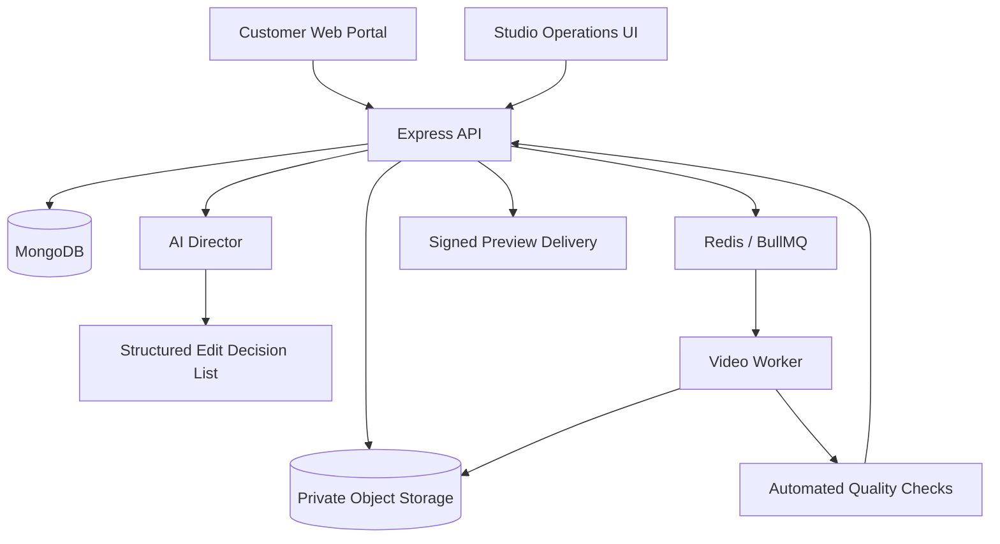

# VDYO Web-first AI Video Studio

## Product boundary

VDYO is a customer-facing web application for creating, processing and delivering edited videos. WhatsApp is an optional future notification/support channel; it is not required for project creation or editing.

## System architecture

## Services

- **Web:** React + Vite; customer project intake, upload progress, project status and preview.
- **API:** Express, schema validation, rate limiting, health and project endpoints.
- **Data:** MongoDB project, customer, asset and job records.
- **Storage:** Private S3-compatible bucket; browser uploads use short-lived signed PUT URLs.
- **AI Director:** Converts project instructions and available media metadata into a structured edit brief. It must not claim visual inspection without actual visual inputs.
- **Queue:** Redis + BullMQ for durable, retryable background jobs.
- **Render worker:** FFmpeg invoked with argument arrays (never shell interpolation), isolated temp directories and resource limits.
- **Quality control:** Validate media streams, duration, dimensions, audio peaks, subtitle timing and output readability before marking a project ready.

## Project lifecycle

`draft → awaiting_uploads → queued → analysing → editing → rendering → quality_check → ready`

Failures move to `failed` with a machine-readable error. Retrying must be idempotent. Customer-facing status must never imply a render exists before the output object has been verified.

## API (initial)

- `GET /api/health` — configured dependency status.
- `POST /api/projects` — create a project.
- `GET /api/projects` — paginated project list.
- `GET /api/projects/:id` — project and expiring asset links.
- `POST /api/projects/:id/uploads` — create a signed upload URL.
- `POST /api/projects/:id/uploads/complete` — verify uploaded object size.
- `POST /api/projects/:id/process` — generate an edit brief and enqueue a job.

## Security requirements before production

1. Add authentication and per-user/tenant authorization to every project and asset endpoint.
2. Validate S3 object ownership, metadata and checksums; add malware scanning and media probing.
3. Add request-size limits, rate limits, MIME sniffing and upload quotas.
4. Keep all storage private and use short-lived signed URLs.
5. Verify provider webhooks with raw request bodies and HMAC signatures.
6. Isolate FFmpeg workers, restrict codecs/protocols, enforce CPU/memory/time quotas.
7. Add deletion/retention controls and audit events for customer media.
8. Add idempotency keys, observability, backup/restore and queue dead-letter handling.

## Current implementation boundary

This branch establishes the project data model, project APIs, signed-upload flow, AI edit-brief generation, queue integration and a worker safety gate. It does **not** yet perform scene-level visual analysis or create a finished MP4. Authentication, full render pipeline, automated QC, payment and production deployment remain future work.
